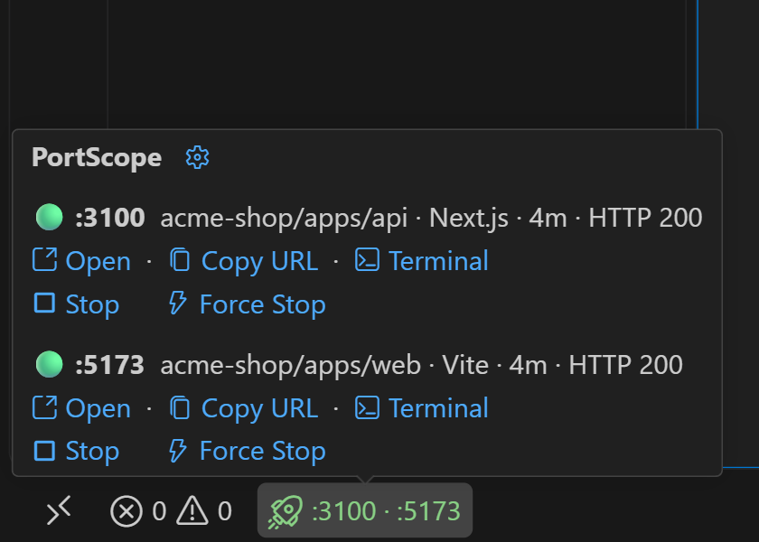
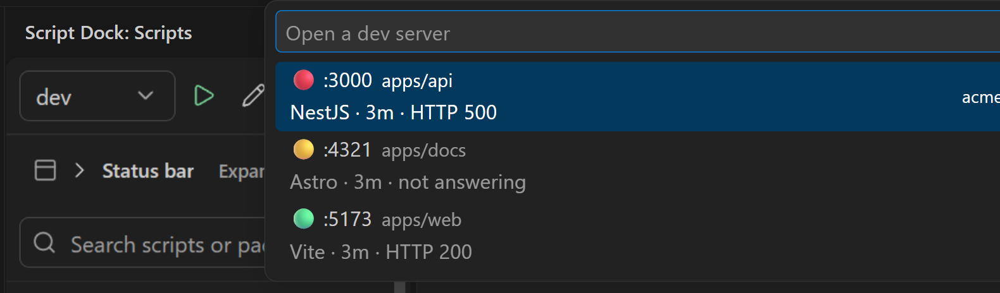
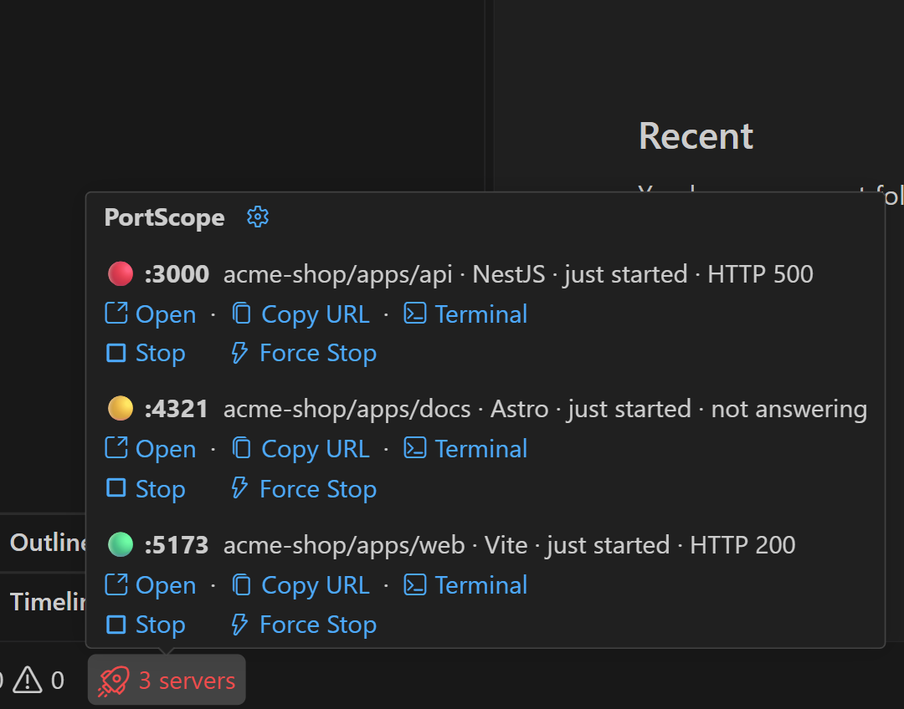
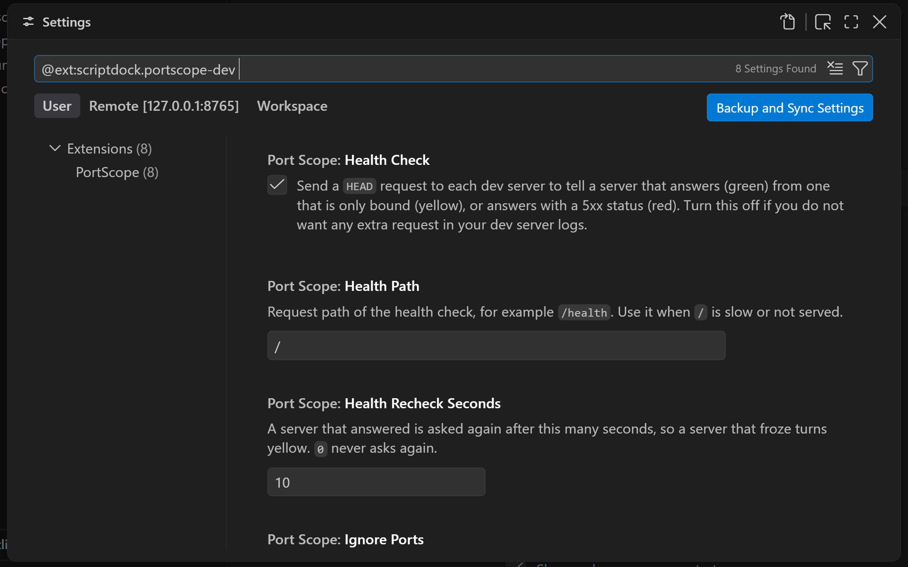

<p align="center"></p>

# PortScope

Shows the dev servers of the current VS Code window in the status bar and opens them in one click. See the [changelog](CHANGELOG.md) for what changed in each release.

<p align="center"></p>

## Behavior

- No server: the status bar item is hidden.
- One server: `🚀 :4200`. A click opens `http://localhost:4200`.
- Two servers: `🚀 :4200 · :8080`. Three or more: `🚀 3 servers`. A click opens a picker.
- The picker groups servers by project (see below). Each row shows the framework (Vite, Angular, Next.js, Spring and others), the uptime and the health, with copy, stop and force stop buttons.
- The hover shows each server as `🟢 :4200 project · Vite · 12m · HTTP 200` with **Open**, **Copy URL**, **Terminal**, **Stop** and **Force Stop** actions. Stop and Force Stop sit on their own line. With more than three servers the actions show only icons. The ⚙ in the hover title opens the PortScope settings.
- Stop sends SIGTERM. Force sends SIGKILL. Neither asks for confirmation. Commands: `PortScope: Open Dev Server`, `PortScope: Copy Dev Server URL`, `PortScope: Stop Dev Server`, `PortScope: Force Stop Dev Server (SIGKILL)`, `PortScope: Show Dev Server Terminal`, `PortScope: Open Settings`.
- Each window shows only servers started from its own workspace folders. There is no global port list.
- In a monorepo, the item shows the sub-folder of the server, for example `acme-shop/apps/web`.

<p align="center"></p>

## How it works

The extension runs on the workspace side (WSL or Linux). Every few seconds it reads `/proc/net/tcp` and `/proc/net/tcp6` for listening sockets. It maps each socket to a process and keeps the process only if its working directory is inside a workspace folder. VS Code server processes are ignored. Scanning pauses while the window is not focused.

Windows without a Linux workspace side (plain local Windows or macOS) show nothing.

## Health dot

A listening socket always accepts a TCP connection, so a connection proves nothing. PortScope sends one `HEAD` request to `localhost` on each port (path `/` by default):

| Dot    | State    | Meaning                                                                   |
| ------ | -------- | ------------------------------------------------------------------------- |
| green  | serving  | The server answered an HTTP request with any status below 500.            |
| red    | failing  | The server answered with a 5xx status.                                    |
| yellow | starting | The port is bound but silent: still compiling, hung, or not an HTTP port. |
| grey   | unknown  | Health check is off.                                                      |

<p align="center"></p>

A silent or failing server is asked again on every scan, so a recovery shows up within one interval. A server that answered is asked again every `healthRecheckSeconds` (10 s by default), so a server that froze turns yellow. If any server is red the status bar item is red, else yellow if any is silent, else green.

## Notifications

- **Ready:** a server that was yellow starts answering. The message has an **Open** button.
- **Stopped:** a server disappears without being stopped from PortScope.

Both can be turned off in the settings. Servers that are already running when the window opens never notify.

## Settings

Open them with `Ctrl+,` and search for "PortScope", from the ⚙ in the hover, or with `PortScope: Open Settings`. Project-specific values (for example `openPath`) belong in `.vscode/settings.json` of that project.

<p align="center"></p>

| Setting                            | Default | Description                                                       |
| ---------------------------------- | ------- | ----------------------------------------------------------------- |
| `portScope.refreshIntervalSeconds` | `2`     | Scan interval while the window is focused.                        |
| `portScope.healthCheck`            | `true`  | Send one `HEAD` request per dev server to check health.           |
| `portScope.healthRecheckSeconds`   | `10`    | Ask a healthy server again after this long. `0` never asks again. |
| `portScope.healthPath`             | `/`     | Request path of the health check, for example `/health`.          |
| `portScope.ignorePorts`            | `[]`    | Ports that are never shown or checked.                            |
| `portScope.openPath`               | `""`    | Path added when you open or copy a URL, for example `/admin`.     |
| `portScope.notifications.ready`    | `true`  | Notify when a silent server starts answering.                     |
| `portScope.notifications.stopped`  | `true`  | Notify when a server stops without being stopped from PortScope.  |

## Development

```bash
bun install
bun run format
bun run lint
bun run test
bun run build
```

Press `F5` ("Run Extension") to start an Extension Development Host. Run `bun run package:vsix` to build `portscope-dev.vsix`.

Minimum VS Code version: 1.141.2.

## Credits

The icon uses the `radar` glyph from [Lucide](https://lucide.dev) (ISC license).
